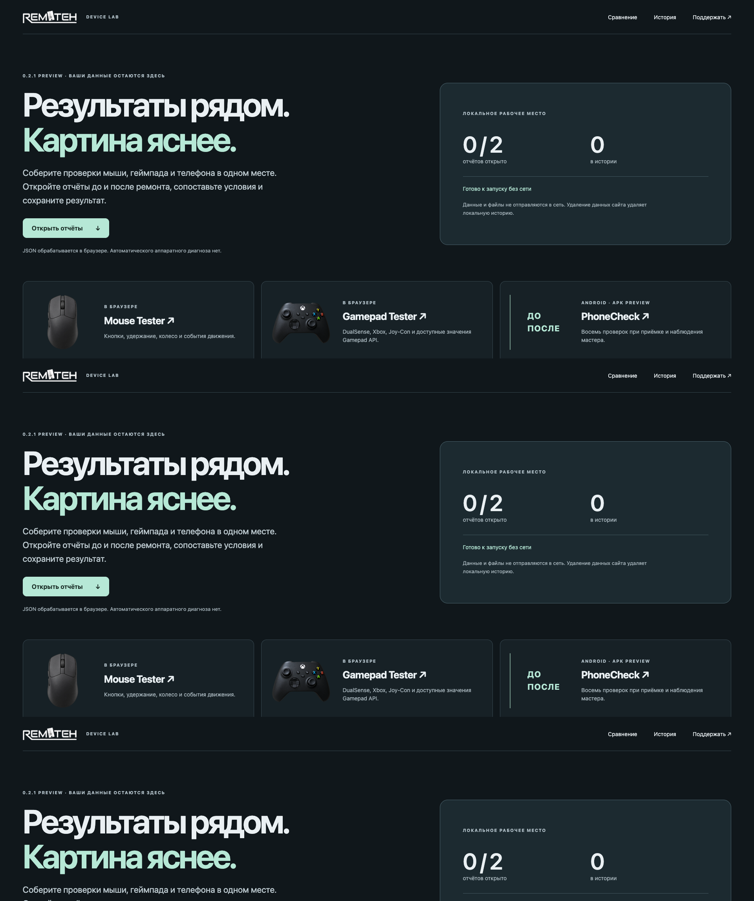
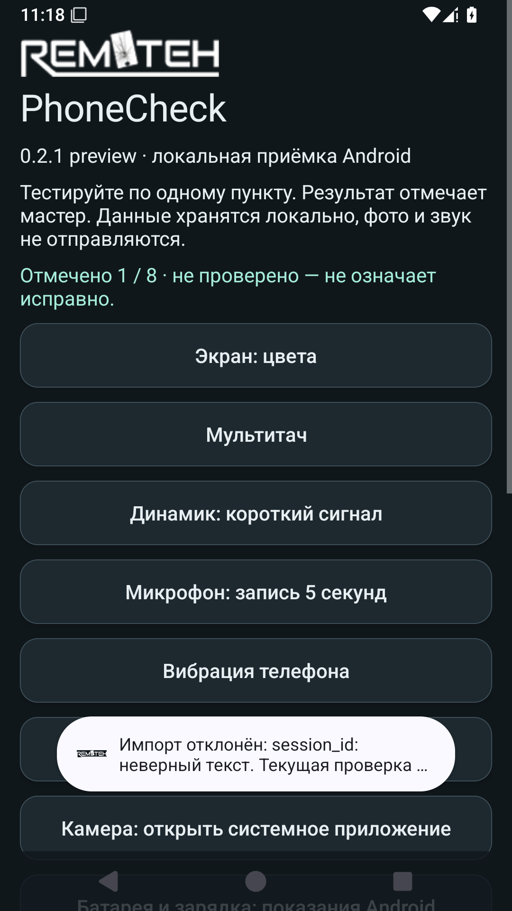

# RemTeh Device Lab 0.2.2 preview

Локальная история и сравнение отчётов мыши, геймпада и телефона до / после ремонта.

[**Открыть Device Lab →**](https://remteh-by.github.io/Device-Lab/) · [PhoneCheck APK, автономный сайт, исходники и SHA-256](https://github.com/remteh-by/Device-Lab/releases/tag/v0.2.2)



В 0.2.1 запись истории сериализуется между вкладками через Web Locks. История 0.2.0 остаётся сохранённой; поздние записи старой вкладки можно отдельно объединить кнопкой «Объединить историю предыдущей версии». Без Web Locks доступны просмотр и экспорт JSON. В 0.2.2 добавлены шесть способов поддержки и обновлён PhoneCheck 0.2.1 b3.

Откройте JSON из Mouse Tester, Android DualSense / Xbox / Joy-Con Tester или PhoneCheck. Исходные файлы обрабатываются в браузере. Условия, источник и версия видны рядом с результатом; при различиях прямое числовое сравнение ограничено. Показания API и наблюдения мастера не являются автоматическим аппаратным диагнозом.

Сохраняйте нужные снимки в локальную историю — до 20 отчётов, общий предел 3 МБ. Экспорт истории переносит отчёты в другой браузер; импорт объединяет их после подтверждения и сохраняет открытые документы. Сохранение при заполненном хранилище отклоняется с объяснением. Повреждённая история не перезаписывается автоматически: доступен экспорт исходной копии. Удаление данных сайта удаляет и локальную историю.

После сообщения «Готово к запуску без сети» сайт открывается после перезапуска браузера офлайн. Обновление сохраняет документы отдельной вкладки и предлагает явную перезагрузку. При отказе хранилища текущая проверка остаётся открыта. PWA кэширует только файлы приложения; отчёты не загружаются на сервер.

## Инструменты

| Программа | Открыть / скачать |
|---|---|
| Mouse Tester | [Онлайн-тест мыши](https://remteh-by.github.io/Mouse-Tester/) |
| Gamepad Tester | [Онлайн-проверка геймпада](https://remteh.by/remont-gamepadov/diagnostika-gejmpada) |
| DualSense / Xbox / Joy-Con для Android | [DualSense](https://github.com/remteh-by/dualsense-tester/releases) · [Xbox](https://github.com/remteh-by/xbox-tester/releases) · [Joy-Con](https://github.com/remteh-by/joycon-tester/releases) |
| PhoneCheck | [APK preview](https://github.com/remteh-by/Device-Lab/releases/tag/v0.2.2) |
| Deckivo / X Play | [Deckivo](https://github.com/remteh-by/remteh-remote-play/releases) · [X Play](https://github.com/remteh-by/x-portal/releases) |

Импорт поддерживает семейство JSON schema 1 из [SESSION-FORMAT.md](SESSION-FORMAT.md). Копируемый текст со стороннего или браузерного тестера не преобразуется в измерения этого формата автоматически. Разные API не считаются одной шкалой.

## PhoneCheck для Android

Восемь локальных проверок: цвета экрана, мультитач, короткий сигнал, запись / прослушивание микрофона, вибрация, датчики, системная камера и сведения о батарее. Мастер отмечает наблюдение, замечание, отсутствие измерения или недоступную функцию. Импорт JSON открывает отдельное сравнение и сохраняет текущую сессию. Подробности и ограничения — [phonecheck/README.md](phonecheck/README.md).



APK подписан debug-сертификатом и является предварительной сборкой. Android 15 SDK-проверка охватывает обновление поверх 0.1.0 с сохранением истории, поворот, импорт, отказ аудио-доступа и сбой записи. Реальные камеры, звук, мотор, питание и разные OEM остаются отдельной аппаратной приёмкой. Приложение не запрашивает INTERNET, контакты, SMS или общую память. Фотографии и временный звук не включаются в JSON. Внешние страницы поддержки / новых версий открываются браузером по нажатию.

## Ubuntu и обновления

[Инструкция установщика Ubuntu](ubuntu/README.md). Он ставит пользовательские ярлыки Mouse Tester, Device Lab, Gamepad Tester и X Play ARM64. Ежечасный таймер проверяет опубликованные GitHub Releases, включая previews; черновики не устанавливаются. Проверяются репозиторий, размер, SHA-256, пути архива, политика сайта и ARM64-бинарник. Текущая и предыдущая версии сохраняются; запущенные версии удерживаются от удаления. Ошибка загрузки, отсутствие места и неудачная запись состояния сохраняют установленное приложение. Откат удерживает неудачную версию до следующего выпуска. Активная проверка сама не перезагружается. Deckivo использует свой отдельный механизм обновлений.

## Канонический Android-код

`diagnostics-core/` содержит Java-измерения: исходные оси, число образцов, окна покоя и интервалы событий. `android/BaseTestActivity.java.template` синхронизирован с выпущенным интерфейсом тестеров. Фильтры отображения отделены от сырых наблюдений. Для трёх соседних checkout выполните:

```sh
python3 tools/sync-testers.py
python3 tools/sync-testers.py --check
```

Каждый `diagnostics-core/SOURCE.json` проверяется по фактическим хешам, включая Android-адаптер. Пакеты, изображения и ключи подписи трёх приложений остаются независимыми.

## Сборка и проверки

Node.js 24, Python 3.11+ и JDK 17:

```sh
npm ci
npx playwright install chromium
npm run build
npm test
npm run test:phone
python3 -m unittest discover -s tests -p test_updates.py
```

Для PhoneCheck нужны SDK 35 и Gradle wrapper: из `phonecheck/` выполните `./gradlew :app:assembleDebug :app:lintDebug`. Тестовый `QualityRunner` запускается только в отдельном SDK-эмуляторе; он не входит в распространяемый APK. Примеры в `examples/` синтетические и не выдают себя за проверку реального устройства.

Проверены 390/1920/2560/3840 px, все три адаптера, неисполняемый текст, некорректные данные, экспорт, отказ хранилища, явное обновление и полный перезапуск браузера офлайн. Платежи и платные ИИ-запросы для проверок не выполнялись. Сохранена действующая [лицензия проекта](LICENSE); новая лицензия не назначалась.

[Выбрать способ поддержки](SUPPORT.md): разовая или регулярная добровольная поддержка, без передачи отчётов или платёжных данных приложению. Приглашение после сохранения отчёта можно скрыть на 30 дней. Факт оплаты приложение автоматически не подтверждает. [Изображения и атрибуция](PHOTO-CREDITS.md).

## Support options

[Ko-fi, Afdian, Boosty, DonationAlerts, DonatePay and OKX Pay](SUPPORT.md). Optional support; each method shows its current setup/payment-verification status.
